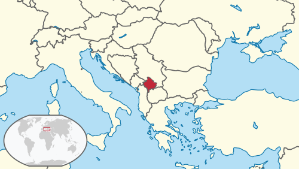

---
id    = "40d19be7-bf4c-5329-8a97-4b3942051cc3"
model = "Basic"
tags  = ["europe", "sovereign_state", "map"]
---

## Front

What is highlighted on this map?

## Back

<b>Kosovo</b>

## Extra

Partially recognised state claimed by Serbia.
