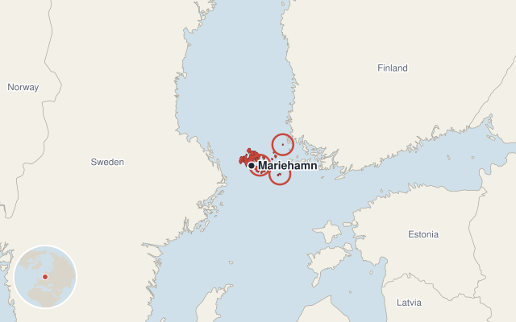

---
id    = "926940f3-253b-5ea8-a8a6-c69190a16f76"
model = "Basic"
tags  = ["europe", "capital"]
---

## Front

What is the capital of <b>Åland Islands</b>?

## Back

<b>Mariehamn</b>

## Extra

Autonomous region of Finland.

<a href="https://en.wikipedia.org/wiki/Mariehamn">Mariehamn on Wikipedia</a> <a href="https://en.wikipedia.org/wiki/%C3%85land">Åland on Wikipedia</a>
