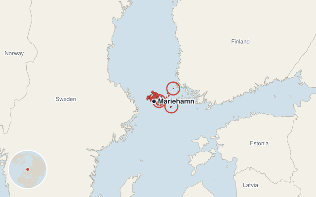

---
id    = "13be1271-d9b2-5cd7-8841-160686888ea1"
model = "Basic"
tags  = ["europe", "country"]
---

## Front

<b>Mariehamn</b> is the capital of which country or territory?

## Back

<b>Åland Islands</b>

## Extra

About 30,800 people (2025), the smallest region of Finland Highest point: Orrdalsklint

An autonomous and demilitarised region of Finland, with autonomy since 1920. Its official language is Swedish.

Autonomous region of Finland.

<a href="https://en.wikipedia.org/wiki/%C3%85land">Åland on Wikipedia</a> <a href="https://en.wikipedia.org/wiki/Mariehamn">Mariehamn on Wikipedia</a>
