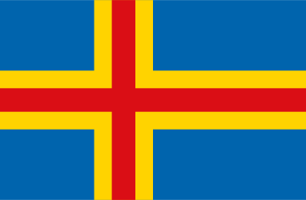

---
id    = "8e984d7e-888e-58f8-ba2e-ae9e0c058700"
model = "Basic"
tags  = ["europe", "flag"]
---

## Front

Whose flag is this?

## Back

<b>Åland Islands</b>

## Extra

Autonomous region of Finland.
