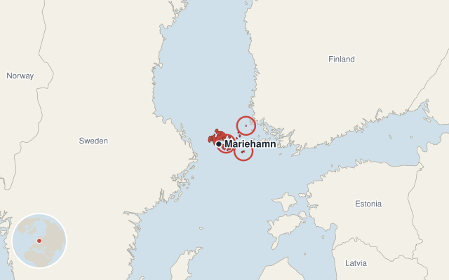

---
id    = "d8633e26-19ea-5894-bdef-e1d8d3c4028d"
model = "Basic"
tags  = ["europe", "map"]
---

## Front

What is highlighted on this map?

## Back

<b>Åland Islands</b>

## Extra

At the entrance to the Gulf of Bothnia in the Baltic Sea About 1,580 km2

Fasta Åland holds 90% of the population, with about 6,500 skerries and islands to its east. The only land border is on the uninhabited skerry of Märket, shared with Sweden.

Autonomous region of Finland.

<a href="https://en.wikipedia.org/wiki/%C3%85land">Åland on Wikipedia</a>
