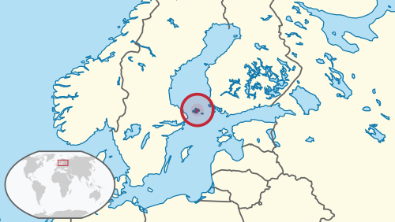

---
id    = "d8633e26-19ea-5894-bdef-e1d8d3c4028d"
model = "Basic"
tags  = ["europe", "map"]
---

## Front

What is highlighted on this map?

## Back

<b>Åland Islands</b>

## Extra

Autonomous region of Finland.
