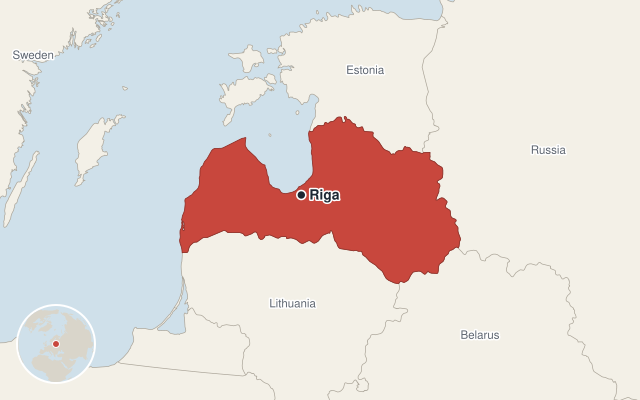
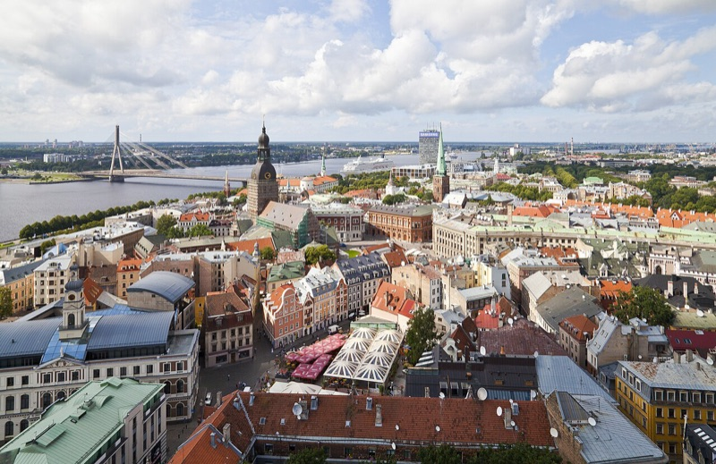

---
id    = "69a48d58-d4fc-5ab4-8d31-0c9f29ee4c11"
model = "Basic"
tags  = ["europe", "european_union", "sovereign_state", "capital"]
---

## Front

What is the capital of <b>Latvia</b>?

## Back

<b>Riga</b>

## Extra

<i>Photo: Diego Delso, Diego Delso, via Wikimedia Commons</i>

About 589,000 people (2026) Flat, sandy plain 1 to 10 m above sea level, at the mouth of the Daugava

Founded in 1201 and a former Hanseatic League member. Its historical centre is a UNESCO World Heritage Site, noted for its Art Nouveau architecture.

<a href="https://en.wikipedia.org/wiki/Riga">Riga on Wikipedia</a> <a href="https://en.wikipedia.org/wiki/Latvia">Latvia on Wikipedia</a>
