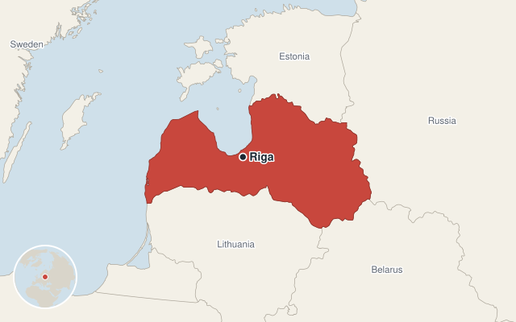

---
id    = "3114b29f-a9bd-5460-a558-9302759c130a"
model = "Basic"
tags  = ["europe", "european_union", "sovereign_state", "country"]
---

## Front

<b>Riga</b> is the capital of which country or territory?

## Back

<b>Latvia</b>

## Extra

<a href="https://en.wikipedia.org/wiki/Latvia">Latvia on Wikipedia</a> <a href="https://en.wikipedia.org/wiki/Riga">Riga on Wikipedia</a>
