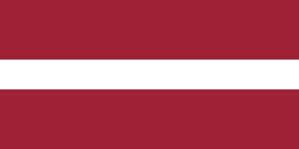
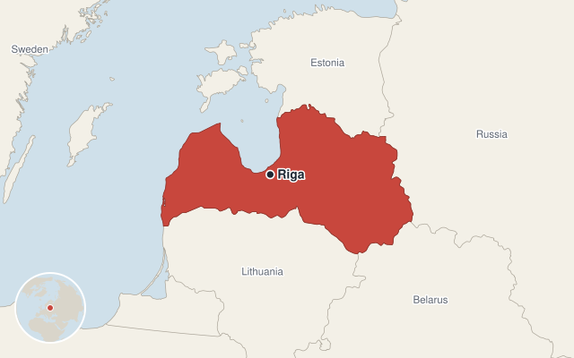

---
id    = "b2f36a85-570a-5413-847d-6ded2d1eaf03"
model = "Basic"
tags  = ["europe", "european_union", "sovereign_state", "flag"]
---

## Front

Whose flag is this?

## Back

<b>Latvia</b>

## Extra

Similar flags: Austria (brighter red, wider white band)

<a href="https://en.wikipedia.org/wiki/Flag_of_Latvia">Flag of Latvia on Wikipedia</a> <a href="https://en.wikipedia.org/wiki/Latvia">Latvia on Wikipedia</a>
