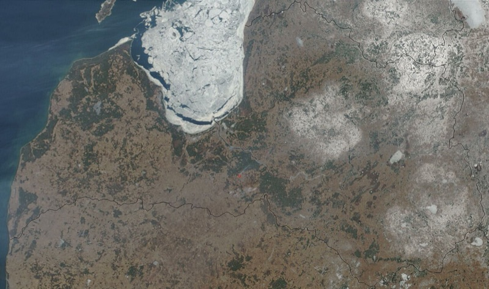

---
id    = "25c86b71-7a63-5085-b2e9-1d85044305bf"
model = "Basic"
tags  = ["europe", "european_union", "sovereign_state", "map"]
---

## Front

What is highlighted on this map?

## Back

<b>Latvia</b>

## Extra

<i>Photo: Jeff Schmaltz, MODIS Rapid Response Team, NASA/GSFC, Public domain, via Wikimedia Commons</i>

Borders Estonia, Lithuania, Belarus and Russia 494 km of Baltic coastline

Mostly fertile lowland plains and moderate hills. The highest point, Gaiziņkalns, reaches only 311.6 m.

<a href="https://en.wikipedia.org/wiki/Latvia">Latvia on Wikipedia</a>
