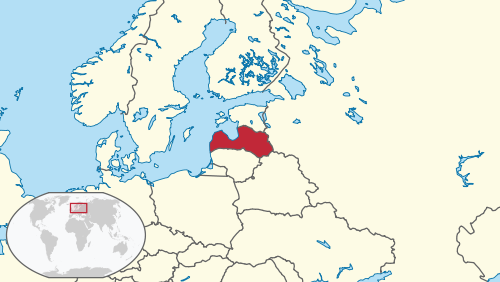

---
id    = "25c86b71-7a63-5085-b2e9-1d85044305bf"
model = "Basic"
tags  = ["europe", "european_union", "sovereign_state", "map"]
---

## Front

What is highlighted on this map?

## Back

<b>Latvia</b>
