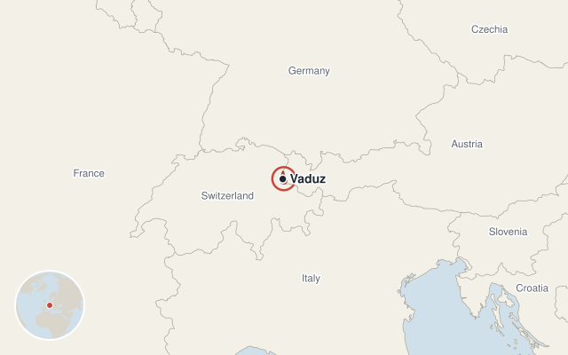
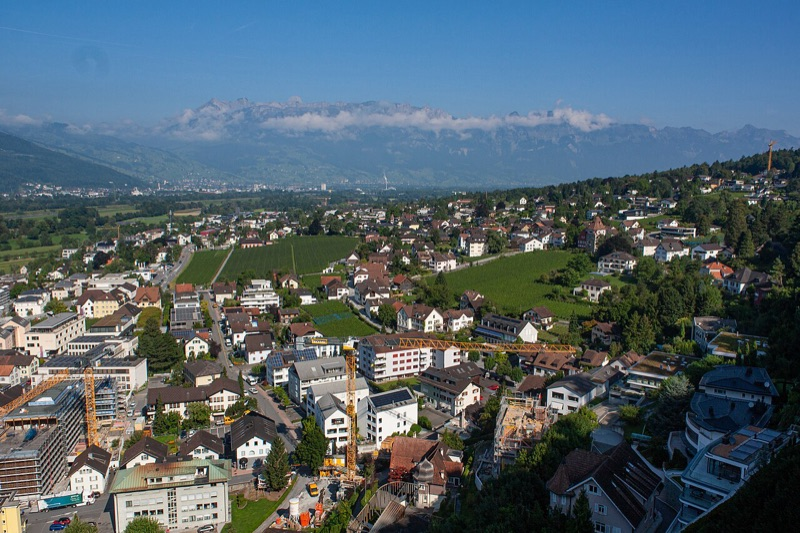

---
id    = "31d99b4e-1c48-5875-bf47-c7919aaf3acc"
model = "Basic"
tags  = ["europe", "sovereign_state", "capital"]
---

## Front

What is the capital of <b>Liechtenstein</b>?

## Back

<b>Vaduz</b>

## Extra

<i>Photo: Lucas Kendall, CC BY-SA 4.0, via Wikimedia Commons</i>

About 5,700 people (2019) 455 m up, along the Rhine

Vaduz Castle, on a steep hill above the town, is home to the reigning prince. Despite being the capital, Vaduz is not the largest town: neighbouring Schaan has more people.

<a href="https://en.wikipedia.org/wiki/Vaduz">Vaduz on Wikipedia</a> <a href="https://en.wikipedia.org/wiki/Liechtenstein">Liechtenstein on Wikipedia</a>
