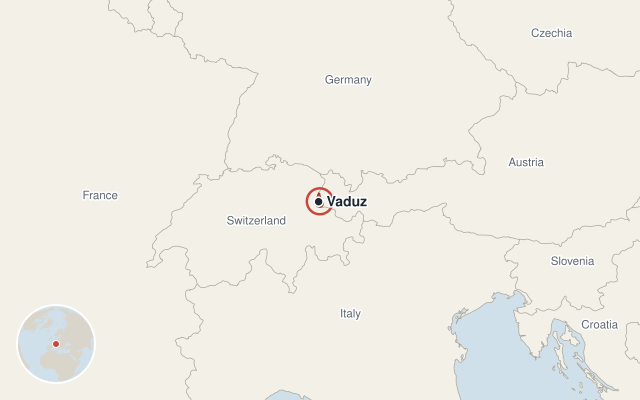

---
id    = "3aebb55a-bacf-52e8-a3bd-3b52d06fbf20"
model = "Basic"
tags  = ["europe", "sovereign_state", "country"]
---

## Front

<b>Vaduz</b> is the capital of which country or territory?

## Back

<b>Liechtenstein</b>

## Extra

About 38,000 people (2019) Doubly landlocked, in the Alps

Europe's fourth-smallest country and the world's smallest to border two countries. It uses the Swiss franc and has a customs union with Switzerland.

<a href="https://en.wikipedia.org/wiki/Liechtenstein">Liechtenstein on Wikipedia</a> <a href="https://en.wikipedia.org/wiki/Vaduz">Vaduz on Wikipedia</a>
