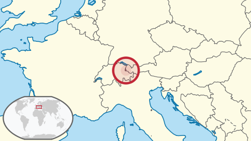
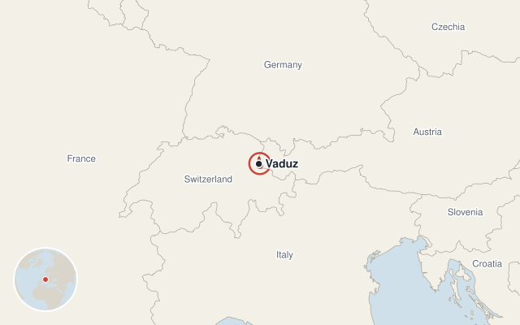

---
id    = "6a69e1e4-f31f-554e-bd0b-b376eaebc98c"
model = "Basic"
tags  = ["europe", "sovereign_state", "map"]
---

## Front

What is highlighted on this map?

## Back

<b>Liechtenstein</b>

## Extra

<a href="https://en.wikipedia.org/wiki/Liechtenstein">Liechtenstein on Wikipedia</a>
