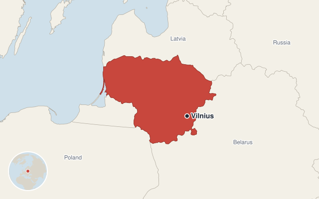

---
id    = "a5d8faff-74e9-5687-a8a6-c79be0af3842"
model = "Basic"
tags  = ["europe", "european_union", "sovereign_state", "capital"]
---

## Front

What is the capital of <b>Lithuania</b>?

## Back

<b>Vilnius</b>

## Extra

<a href="https://en.wikipedia.org/wiki/Vilnius">Vilnius on Wikipedia</a> <a href="https://en.wikipedia.org/wiki/Lithuania">Lithuania on Wikipedia</a>
