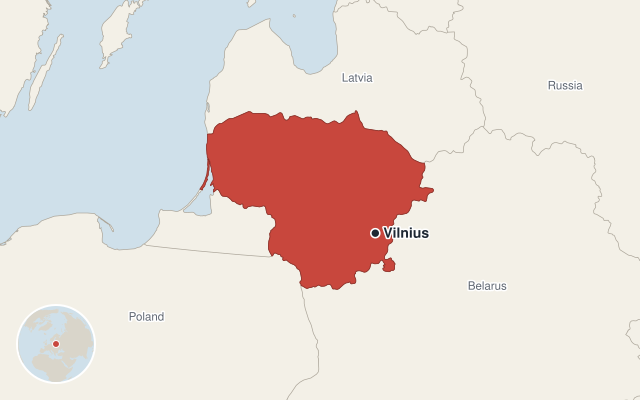

---
id    = "951bb940-8979-5738-a18a-36f3d86b219a"
model = "Basic"
tags  = ["europe", "european_union", "sovereign_state", "country"]
---

## Front

<b>Vilnius</b> is the capital of which country or territory?

## Back

<b>Lithuania</b>

## Extra

About 2.86 million people (2023) One of the three Baltic states

On 11 March 1990 it became the first Soviet republic to break away from the Soviet Union. In the 14th century its Grand Duchy was the largest country in Europe.

<a href="https://en.wikipedia.org/wiki/Lithuania">Lithuania on Wikipedia</a> <a href="https://en.wikipedia.org/wiki/Vilnius">Vilnius on Wikipedia</a>
