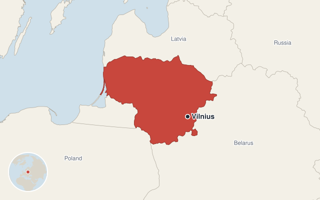

---
id    = "7c13cbb9-45c7-5060-8147-9332f64ecc1a"
model = "Basic"
tags  = ["europe", "european_union", "sovereign_state", "flag"]
---

## Front

Whose flag is this?

## Back

<b>Lithuania</b>

## Extra

<a href="https://en.wikipedia.org/wiki/Flag_of_Lithuania">Flag of Lithuania on Wikipedia</a> <a href="https://en.wikipedia.org/wiki/Lithuania">Lithuania on Wikipedia</a>
