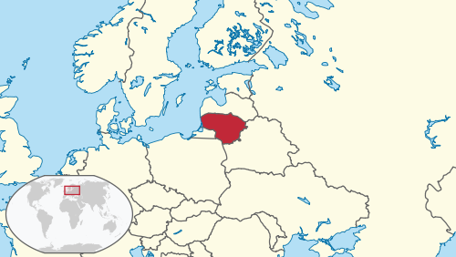

---
id    = "fbcfbedb-80cd-57c4-84fb-d350d5d84198"
model = "Basic"
tags  = ["europe", "european_union", "sovereign_state", "map"]
---

## Front

What is highlighted on this map?

## Back

<b>Lithuania</b>
