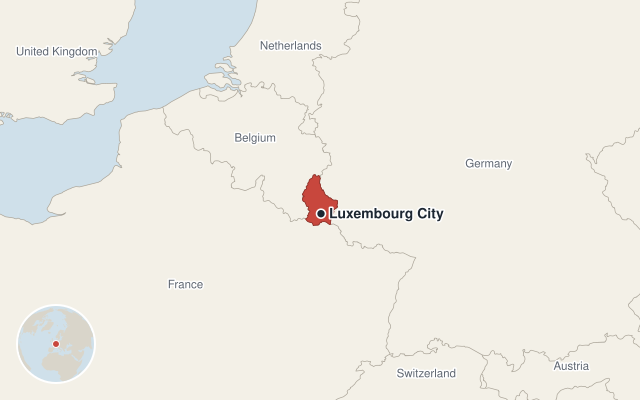

---
id    = "4d233802-fea4-53b0-a3b4-cbf6d81d88ac"
model = "Basic"
tags  = ["europe", "european_union", "sovereign_state", "capital"]
---

## Front

What is the capital of <b>Luxembourg</b>?

## Back

<b>Luxembourg City</b>

## Extra

About 138,000 people (2026) 300 m up, where the Alzette and Pétrusse rivers meet

Its fortress held out so long under siege that the French engineer Lazare Carnot called it "the best fortress in the world, except Gibraltar", which gave the city the nickname "Gibraltar of the North".

Officially Luxembourg.

<a href="https://en.wikipedia.org/wiki/Luxembourg_City">Luxembourg City on Wikipedia</a> <a href="https://en.wikipedia.org/wiki/Luxembourg">Luxembourg on Wikipedia</a>
