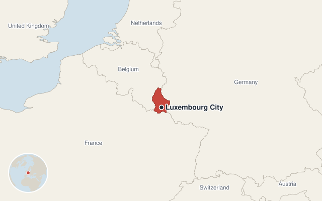

---
id    = "c2a1ab2b-7b3e-5fca-934c-3c1aec9b9144"
model = "Basic"
tags  = ["europe", "european_union", "sovereign_state", "country"]
---

## Front

<b>Luxembourg City</b> is the capital of which country or territory?

## Back

<b>Luxembourg</b>

## Extra

About 696,000 people (2026), almost half of them foreign nationals Europe's seventh-smallest country, 2,586 km²

The world's only remaining sovereign grand duchy, headed by Grand Duke Guillaume V. Luxembourgish is the only recognised national language, and French is the sole language for legislation.

Officially Luxembourg.

<a href="https://en.wikipedia.org/wiki/Luxembourg">Luxembourg on Wikipedia</a> <a href="https://en.wikipedia.org/wiki/Luxembourg_City">Luxembourg City on Wikipedia</a>
