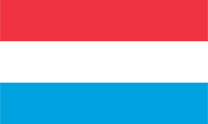

---
id    = "ef310d97-52ec-52af-a15b-188b3331b783"
model = "Basic"
tags  = ["europe", "european_union", "sovereign_state", "flag"]
---

## Front

Whose flag is this?

## Back

<b>Luxembourg</b>

## Extra

Similar flags: Netherlands (darker blue)
