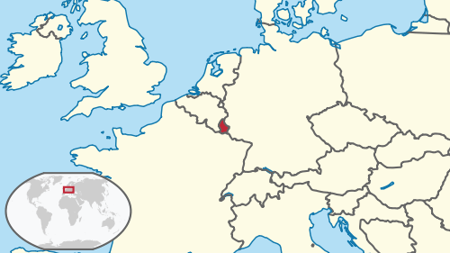
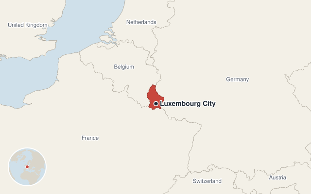

---
id    = "198e39bb-7b6f-52e7-bea3-e3d62ffe86f8"
model = "Basic"
tags  = ["europe", "european_union", "sovereign_state", "map"]
---

## Front

What is highlighted on this map?

## Back

<b>Luxembourg</b>

## Extra

Borders Belgium, Germany and France At most 82 km north to south and 57 km west to east

The hilly northern third, the Éislek or Oesling, is part of the Ardennes and holds the highest point, the Kneiff, at 560 m. The southern two-thirds, the Guttland, is more densely populated.

<a href="https://en.wikipedia.org/wiki/Luxembourg">Luxembourg on Wikipedia</a>
