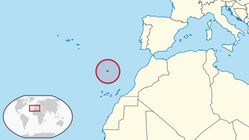

---
id    = "d8a4be41-2910-5b30-a72b-d3877a298fe4"
model = "Basic"
tags  = ["europe", "map"]
---

## Front

What is highlighted on this map?

## Back

<b>Madeira</b>

## Extra

About 251,000 people (2021) About 805 km southwest of mainland Portugal, in the Atlantic

The archipelago includes the islands of Madeira, Porto Santo and the Desertas, administered together with the separate Savage Islands. Roughly half of the population lives in Funchal.

Autonomous region of Portugal.

<a href="https://en.wikipedia.org/wiki/Madeira">Madeira on Wikipedia</a>
