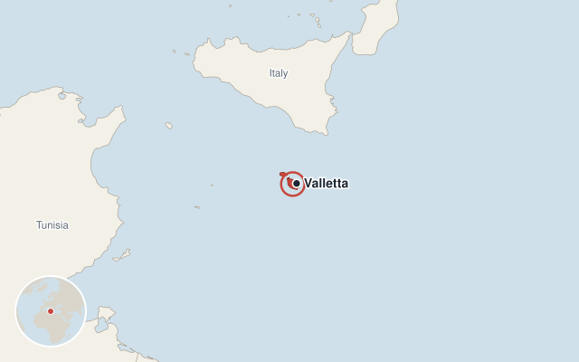
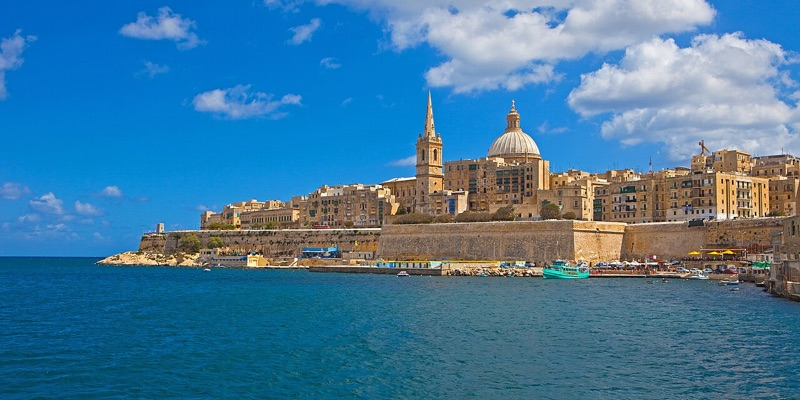

---
id    = "743b5fb1-7c27-54cb-a3d0-2050e7c583a5"
model = "Basic"
tags  = ["europe", "european_union", "mediterranean", "sovereign_state", "capital"]
---

## Front

What is the capital of <b>Malta</b>?

## Back

<b>Valletta</b>

## Extra

<i>Photo: Bengt Nyman, Bengt Nyman, via Wikimedia Commons</i>

About 5,200 people (2024) At 0.61 km², the European Union's smallest capital city

Named after Jean Parisot de Valette, who defended the island in the Great Siege of Malta, and built by the Knights Hospitaller in the 16th century. It is also the southernmost capital of Europe.

<a href="https://en.wikipedia.org/wiki/Valletta">Valletta on Wikipedia</a> <a href="https://en.wikipedia.org/wiki/Malta">Malta on Wikipedia</a>
