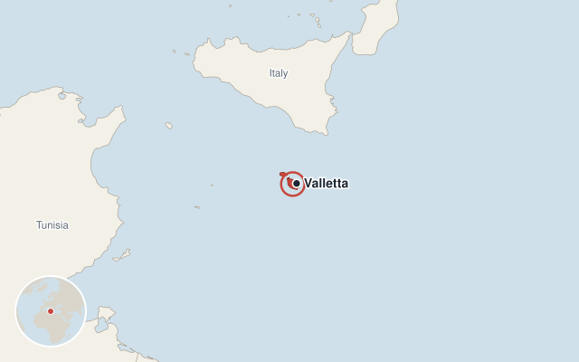

---
id    = "d621b536-e603-518b-8b81-c3f8a90ea8c9"
model = "Basic"
tags  = ["europe", "european_union", "mediterranean", "sovereign_state", "country"]
---

## Front

<b>Valletta</b> is the capital of which country or territory?

## Back

<b>Malta</b>

## Extra

<a href="https://en.wikipedia.org/wiki/Malta">Malta on Wikipedia</a> <a href="https://en.wikipedia.org/wiki/Valletta">Valletta on Wikipedia</a>
