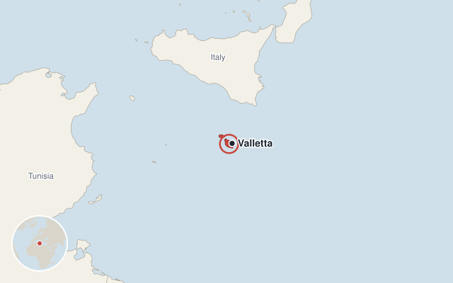

---
id    = "142ea315-6b8a-58b6-86f0-fd4fccbadeec"
model = "Basic"
tags  = ["europe", "european_union", "mediterranean", "sovereign_state", "flag"]
---

## Front

Whose flag is this?

## Back

<b>Malta</b>

## Extra

<a href="https://en.wikipedia.org/wiki/Flag_of_Malta">Flag of Malta on Wikipedia</a> <a href="https://en.wikipedia.org/wiki/Malta">Malta on Wikipedia</a>
