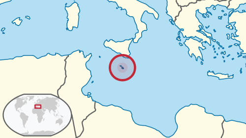
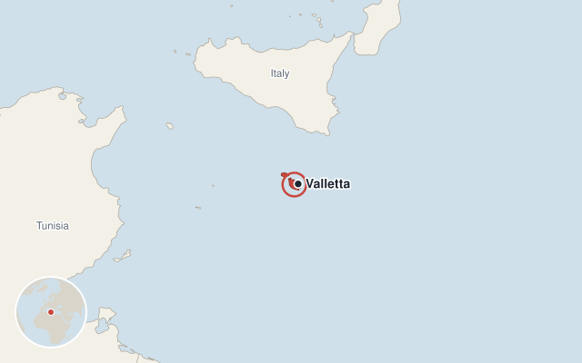

---
id    = "45951e7d-895b-5f0e-b1d1-a67398776b6f"
model = "Basic"
tags  = ["europe", "european_union", "mediterranean", "sovereign_state", "map"]
---

## Front

What is highlighted on this map?

## Back

<b>Malta</b>

## Extra

<a href="https://en.wikipedia.org/wiki/Malta">Malta on Wikipedia</a>
