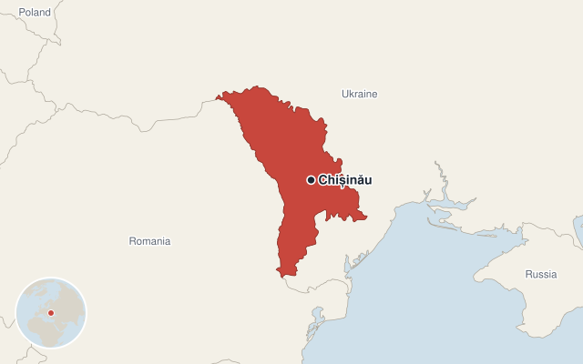

---
id    = "c87acd5e-076f-5601-bf18-b5f2b7227f30"
model = "Basic"
tags  = ["europe", "sovereign_state", "capital"]
---

## Front

What is the capital of <b>Moldova</b>?

## Back

<b>Chișinău</b>

## Extra

About 567,000 people (2024 census) in the city proper On the river Bîc, a tributary of the Dniester

Formerly known by its Russian form, Kishinev. It hosts the national wine festival every October, in a country whose winemaking dates back to at least 3,000 BC.

<a href="https://en.wikipedia.org/wiki/Chi%C8%99in%C4%83u">Chișinău on Wikipedia</a> <a href="https://en.wikipedia.org/wiki/Moldova">Moldova on Wikipedia</a>
