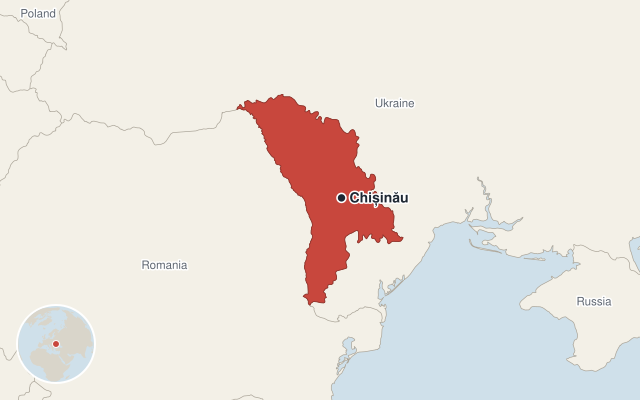

---
id    = "19c8a5e5-0b80-511b-9592-94541ebec081"
model = "Basic"
tags  = ["europe", "sovereign_state", "country"]
---

## Front

<b>Chișinău</b> is the capital of which country or territory?

## Back

<b>Moldova</b>

## Extra

<a href="https://en.wikipedia.org/wiki/Moldova">Moldova on Wikipedia</a> <a href="https://en.wikipedia.org/wiki/Chi%C8%99in%C4%83u">Chișinău on Wikipedia</a>
