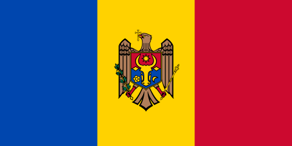

---
id    = "7335b323-c932-54bd-b4f2-c118681e0020"
model = "Basic"
tags  = ["europe", "sovereign_state", "flag"]
---

## Front

Whose flag is this?

## Back

<b>Moldova</b>

## Extra

Similar flags: Andorra (narrower, coat of arms with motto)
