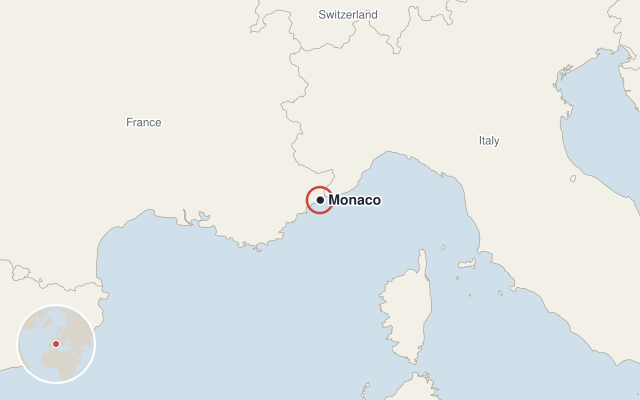

---
id    = "4de93c60-3feb-5bad-8fdd-e02cc3800fae"
model = "Basic"
tags  = ["europe", "mediterranean", "sovereign_state", "capital"]
---

## Front

What is the capital of <b>Monaco</b>?

## Back

<b>Monaco</b>

## Extra

About 38,900 people (2025) in 2.08 km² On the French Riviera, on the Mediterranean

The city and the country are the same place: a city-state, the second smallest sovereign state in the world after Vatican City and the most densely populated.

<a href="https://en.wikipedia.org/wiki/Monaco">Monaco on Wikipedia</a>
