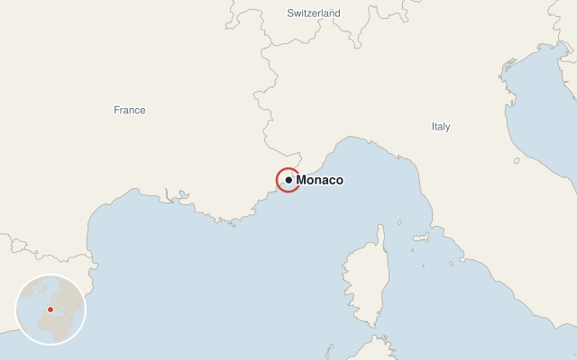

---
id    = "42eb1c9d-4199-583c-8164-c3291e546e57"
model = "Basic"
tags  = ["europe", "mediterranean", "sovereign_state", "country"]
---

## Front

<b>Monaco</b> is the capital of which country or territory?

## Back

<b>Monaco</b>

## Extra

<a href="https://en.wikipedia.org/wiki/Monaco">Monaco on Wikipedia</a>
