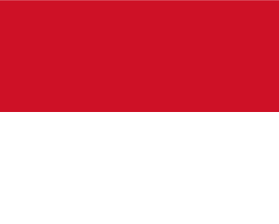
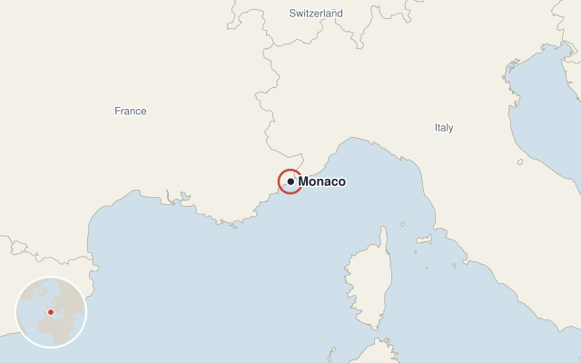

---
id    = "ac106579-dd0f-53ac-99df-ed130755fc81"
model = "Basic"
tags  = ["europe", "mediterranean", "sovereign_state", "flag"]
---

## Front

Whose flag is this?

## Back

<b>Monaco</b>

## Extra

Similar flags: Indonesia (wider, brighter red), Poland (red and white flipped, wider)

<a href="https://en.wikipedia.org/wiki/Flag_of_Monaco">Flag of Monaco on Wikipedia</a> <a href="https://en.wikipedia.org/wiki/Monaco">Monaco on Wikipedia</a>
