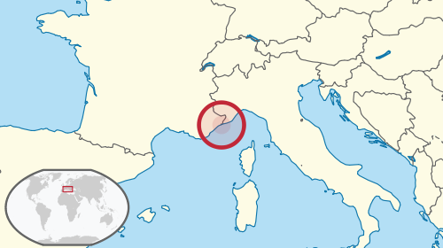

---
id    = "82eeb7c5-80fc-59c0-bc56-2a3b4551fb61"
model = "Basic"
tags  = ["europe", "mediterranean", "sovereign_state", "map"]
---

## Front

What is highlighted on this map?

## Back

<b>Monaco</b>
