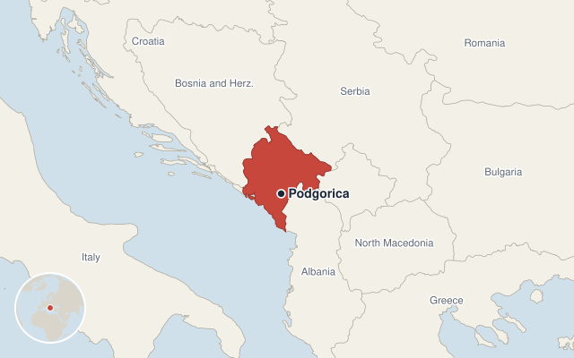

---
id    = "b84869e3-17ab-52b6-9a26-e11182ffc51b"
model = "Basic"
tags  = ["europe", "mediterranean", "sovereign_state", "capital"]
---

## Front

What is the capital of <b>Montenegro</b>?

## Back

<b>Podgorica</b>

## Extra

Cetinje is an honorary capital.

<a href="https://en.wikipedia.org/wiki/Podgorica">Podgorica on Wikipedia</a> <a href="https://en.wikipedia.org/wiki/Montenegro">Montenegro on Wikipedia</a>
