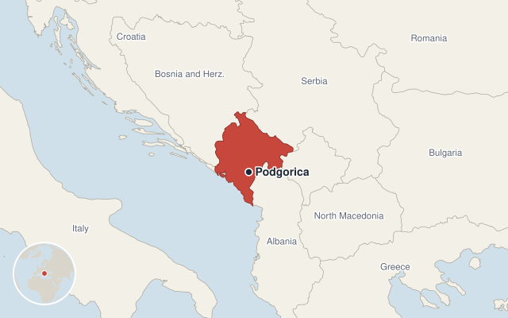

---
id    = "2823e567-e4ac-57a1-a546-20cb760e1ca0"
model = "Basic"
tags  = ["europe", "mediterranean", "sovereign_state", "country"]
---

## Front

<b>Podgorica</b> is the capital of which country or territory?

## Back

<b>Montenegro</b>

## Extra

Cetinje is an honorary capital.

<a href="https://en.wikipedia.org/wiki/Montenegro">Montenegro on Wikipedia</a> <a href="https://en.wikipedia.org/wiki/Podgorica">Podgorica on Wikipedia</a>
