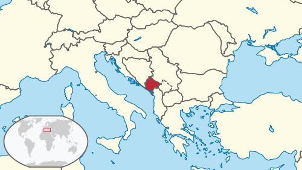
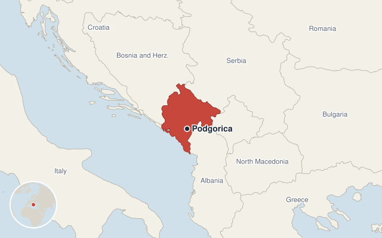

---
id    = "2449f6f8-b821-5537-9a11-692a5b2d3cab"
model = "Basic"
tags  = ["europe", "mediterranean", "sovereign_state", "map"]
---

## Front

What is highlighted on this map?

## Back

<b>Montenegro</b>

## Extra

Borders Serbia, Bosnia and Herzegovina, Kosovo, Albania and Croatia Highest point: Zla Kolata

It lies on the Balkan Peninsula, with a coastline along the Adriatic Sea to the southwest.

<a href="https://en.wikipedia.org/wiki/Montenegro">Montenegro on Wikipedia</a>
