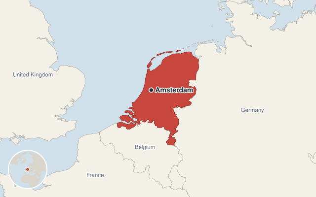

---
id    = "9b717f92-b4bf-58b1-b0ed-1267eb30970b"
model = "Basic"
tags  = ["europe", "european_union", "sovereign_state", "capital"]
---

## Front

What is the capital of <b>Netherlands</b>?

## Back

<b>Amsterdam</b>

## Extra

About 942,000 people (2026) in the city proper About 2 m below sea level, at the mouth of the Amstel

The name means "Dam in the Amstel": the city began as a fishing village in the 12th century at a dammed river mouth. It is nicknamed the "Venice of the North" for its canals.

While Amsterdam is the official capital, The Hague is the seat of the executive and legislative branches.

<a href="https://en.wikipedia.org/wiki/Amsterdam">Amsterdam on Wikipedia</a> <a href="https://en.wikipedia.org/wiki/Netherlands">Netherlands on Wikipedia</a>
