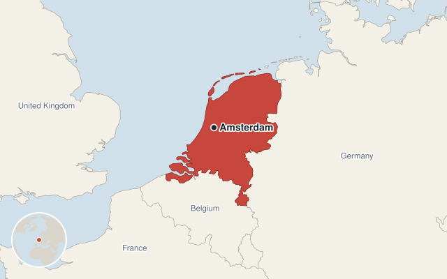

---
id    = "0f51985d-a3f1-505d-99f0-0024a42ba3ff"
model = "Basic"
tags  = ["europe", "european_union", "sovereign_state", "country"]
---

## Front

<b>Amsterdam</b> is the capital of which country or territory?

## Back

<b>Netherlands</b>

## Extra

While Amsterdam is the official capital, The Hague is the seat of the executive and legislative branches.

<a href="https://en.wikipedia.org/wiki/Netherlands">Netherlands on Wikipedia</a> <a href="https://en.wikipedia.org/wiki/Amsterdam">Amsterdam on Wikipedia</a>
