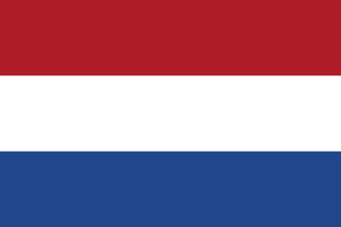
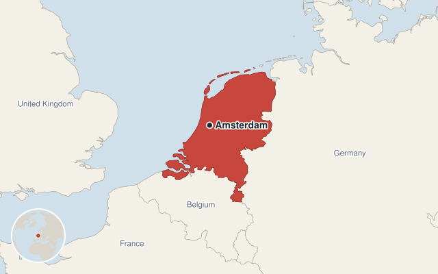

---
id    = "ba6c2d6a-2668-5fd0-b1a0-83011ead0179"
model = "Basic"
tags  = ["europe", "european_union", "sovereign_state", "flag"]
---

## Front

Whose flag is this?

## Back

<b>Netherlands</b>

## Extra

Similar flags: Luxembourg (lighter blue)

<a href="https://en.wikipedia.org/wiki/Flag_of_the_Netherlands">Flag of the Netherlands on Wikipedia</a> <a href="https://en.wikipedia.org/wiki/Netherlands">Netherlands on Wikipedia</a>
