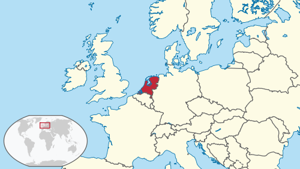

---
id    = "7e5e73d7-265b-5033-8881-04301ed6a2f3"
model = "Basic"
tags  = ["europe", "european_union", "sovereign_state", "map"]
---

## Front

What is highlighted on this map?

## Back

<b>Netherlands</b>
