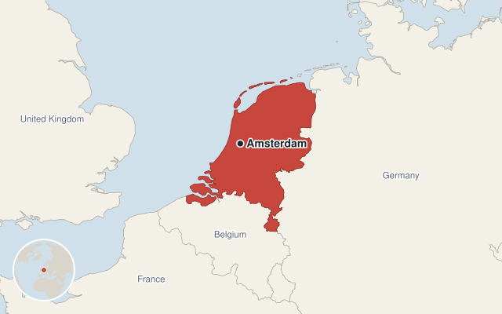

---
id    = "7e5e73d7-265b-5033-8881-04301ed6a2f3"
model = "Basic"
tags  = ["europe", "european_union", "sovereign_state", "map"]
---

## Front

What is highlighted on this map?

## Back

<b>Netherlands</b>

## Extra

Borders Germany and Belgium About 17.9 million people (2024) in 37,378 km²

Netherlands means "lower countries": 26% of the land is below sea level. Most of that is polders, reclaimed from the water since the 14th century.

<a href="https://en.wikipedia.org/wiki/Netherlands">Netherlands on Wikipedia</a>
