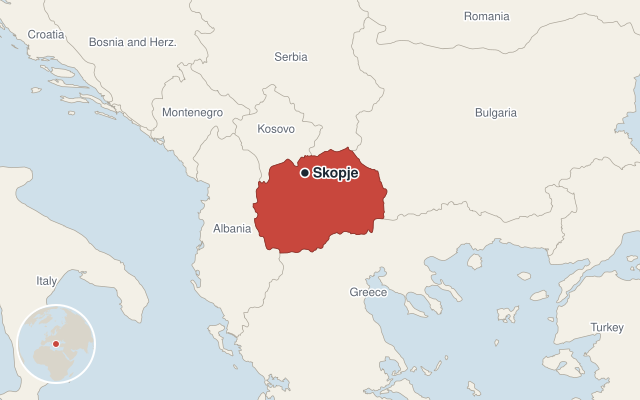
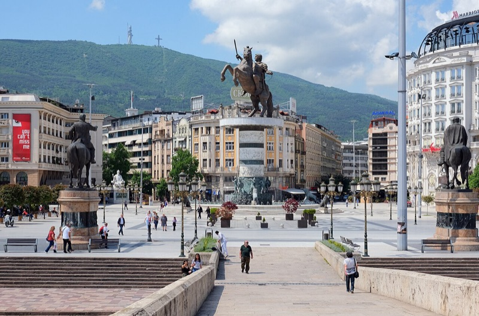

---
id    = "6c0de428-efd2-5ee7-ba16-e00f77feb80b"
model = "Basic"
tags  = ["europe", "sovereign_state", "capital"]
---

## Front

What is the capital of <b>North Macedonia</b>?

## Back

<b>Skopje</b>

## Extra

<i>Photo: kallerna, CC BY-SA 4.0, via Wikimedia Commons</i>

About 527,000 people (2021 census), a quarter of the country On the Vardar River in the Skopje Valley

Founded as Scupi in the late 1st century under Domitian, it was abandoned in 518 after an earthquake destroyed it. It was rebuilt under Justinian I and ruled by the Ottomans for over five centuries.

Formerly known as Macedonia.

<a href="https://en.wikipedia.org/wiki/Skopje">Skopje on Wikipedia</a> <a href="https://en.wikipedia.org/wiki/North_Macedonia">North Macedonia on Wikipedia</a>
