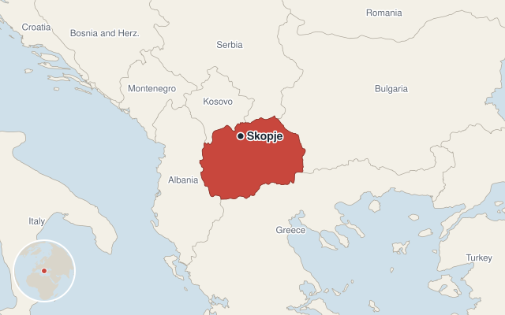

---
id    = "adfcc832-6e96-5b6e-ba2d-d70c524aaf58"
model = "Basic"
tags  = ["europe", "sovereign_state", "country"]
---

## Front

<b>Skopje</b> is the capital of which country or territory?

## Back

<b>North Macedonia</b>

## Extra

About 1.84 million people (2021) in 25,713 km² Landlocked

It makes up approximately the northern third of the larger geographical region of Macedonia. Ethnic Macedonians are the majority, with Albanians at around 25%.

Formerly known as Macedonia.

<a href="https://en.wikipedia.org/wiki/North_Macedonia">North Macedonia on Wikipedia</a> <a href="https://en.wikipedia.org/wiki/Skopje">Skopje on Wikipedia</a>
