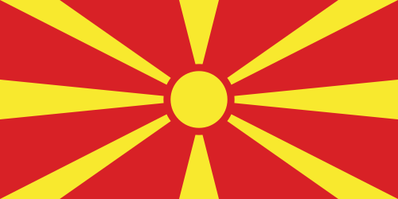
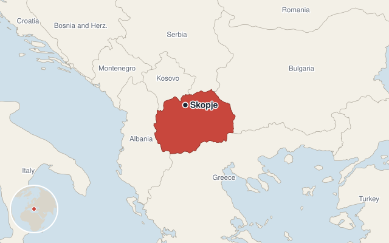

---
id    = "76be2b0d-74d4-5e0b-99eb-05dc6f56ea91"
model = "Basic"
tags  = ["europe", "sovereign_state", "flag"]
---

## Front

Whose flag is this?

## Back

<b>North Macedonia</b>

## Extra

Formerly known as Macedonia.

<a href="https://en.wikipedia.org/wiki/Flag_of_North_Macedonia">Flag of North Macedonia on Wikipedia</a> <a href="https://en.wikipedia.org/wiki/North_Macedonia">North Macedonia on Wikipedia</a>
