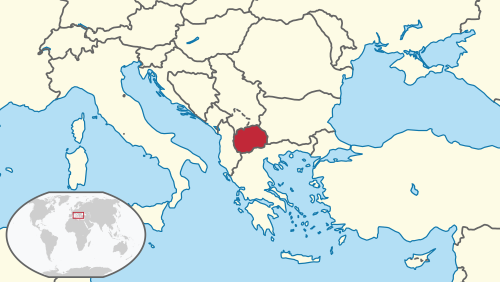

---
id    = "3899349c-fd75-532a-9bde-654b9eb58318"
model = "Basic"
tags  = ["europe", "sovereign_state", "map"]
---

## Front

What is highlighted on this map?

## Back

<b>North Macedonia</b>

## Extra

Formerly known as Macedonia.
