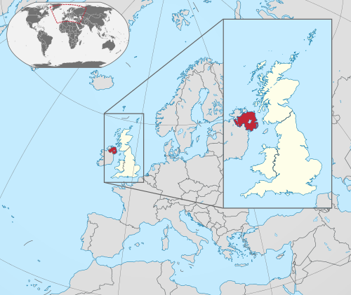

---
id    = "37c80693-cf50-50ae-a9c5-801de45c94e2"
model = "Basic"
tags  = ["europe", "map"]
---

## Front

What is highlighted on this map?

## Back

<b>Northern Ireland</b>

## Extra

Constituent country of the United Kingdom.
