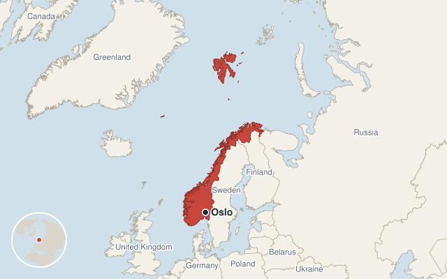

---
id    = "105c076b-7663-5f2a-9398-bc9f8232d327"
model = "Basic"
tags  = ["europe", "sovereign_state", "capital"]
---

## Front

What is the capital of <b>Norway</b>?

## Back

<b>Oslo</b>

## Extra

<a href="https://en.wikipedia.org/wiki/Oslo">Oslo on Wikipedia</a> <a href="https://en.wikipedia.org/wiki/Norway">Norway on Wikipedia</a>
