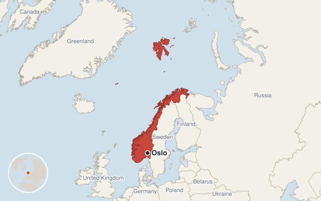

---
id    = "77cddf8e-6a84-5280-8f21-75c5326a3447"
model = "Basic"
tags  = ["europe", "sovereign_state", "country"]
---

## Front

<b>Oslo</b> is the capital of which country or territory?

## Back

<b>Norway</b>

## Extra

About 5.6 million people (2026) Official languages include Norwegian and Sámi

The Kingdom of Norway was established in 872 and has existed continuously for over a millennium. It was in a personal union with Sweden from 1814 to 1905.

<a href="https://en.wikipedia.org/wiki/Norway">Norway on Wikipedia</a> <a href="https://en.wikipedia.org/wiki/Oslo">Oslo on Wikipedia</a>
