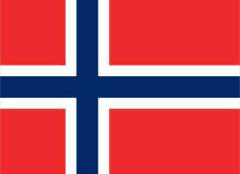
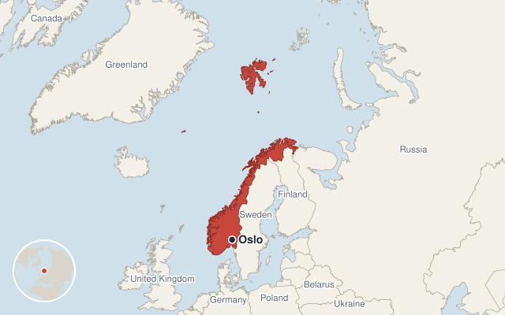

---
id    = "4173ecd5-a5eb-5457-a21f-9ff561e6cb03"
model = "Basic"
tags  = ["europe", "sovereign_state", "flag"]
---

## Front

Whose flag is this?

## Back

<b>Norway</b>

## Extra

Adopted on 13 July 1821

Red with a navy blue Scandinavian cross bordered in white. The vertical part of the cross sits toward the hoist, in the style of the Danish Dannebrog.

Similar flags: Iceland (blue background, red cross), Faroe Islands (white background, red and blue cross)

<a href="https://en.wikipedia.org/wiki/Flag_of_Norway">Flag of Norway on Wikipedia</a> <a href="https://en.wikipedia.org/wiki/Norway">Norway on Wikipedia</a>
